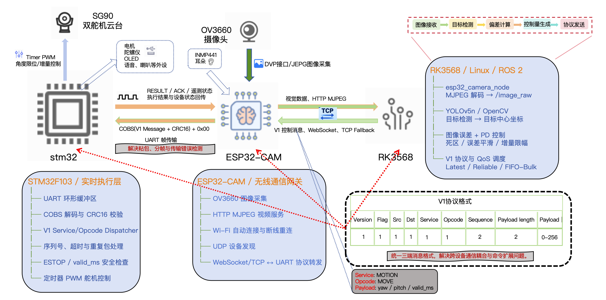

# OpenEmbodied_Lab

OpenEmbodied_Lab 是一个面向机器人、嵌入式系统与具身智能的开源实验项目，覆盖 ROS 2、Embedded Linux、STM32、ESP32、RK3568、计算机视觉及机器人控制。

## 当前项目

### ROS 2 ESP32-CAM 主动视觉云台

本项目基于 **RK3568 + ESP32-CAM + STM32F103** 构建无线主动视觉云台：ESP32-CAM 负责图像采集与无线网关，RK3568/Linux 负责 ROS 2 视觉感知和控制量计算，STM32 负责协议解析、安全检查及双舵机实时控制。

主要能力：

- OV3660 图像采集与 HTTP MJPEG 视频流
- ROS 2 图像发布、OpenCV 颜色跟踪与 YOLOv5n 目标检测
- 基于图像位置误差的 PD 云台控制
- Linux、ESP32 与 STM32 共用的 V1 轻量应用层协议
- WebSocket/TCP 网络控制与 COBS + CRC16 串口帧传输
- Wi-Fi 自动连接、SoftAP 配网、断线重连与 UDP 设备发现
- STM32 指令超时、重复包过滤、ESTOP 与 PWM 舵机控制

## 系统架构

<p align="center">
  
</p>

系统包含三条主要链路：

1. **视觉链路：** OV3660 采集 JPEG 图像，ESP32-CAM 通过 HTTP MJPEG 发送至 RK3568；ROS 2 发布 `/image_raw`，YOLOv5n/OpenCV 输出目标中心坐标。
2. **控制链路：** PD 控制器根据图像中心偏差生成 yaw/pitch 控制量，并封装为 V1 `MOTION/MOVE` 消息，通过 WebSocket 发送至 ESP32-CAM。
3. **实时执行链路：** ESP32-CAM 将 V1 消息封装为 `COBS(V1 + CRC16) + 0x00` 串口帧；STM32 完成校验、安全检查和 PWM 输出，并沿原链路回传执行结果与遥测状态。

> 图中的 INMP441、音频和其他外设表示预留扩展方向；当前已完成的功能以“功能状态”和“开发计划”章节为准。RK3568 部署仍在进行中，现有 ROS 2 节点已在 Linux 环境完成联调。

## 功能状态

### 已完成

- [x] ESP32-CAM OV3660 初始化、PSRAM 检测与 JPEG 采集
- [x] HTTP 单帧抓取与 MJPEG 视频流
- [x] ROS 2 ESP32-CAM 图像接收及 `/image_raw` 发布
- [x] OpenCV 颜色目标检测
- [x] PyTorch YOLOv5n 人体检测与最新帧推理
- [x] `/yolov5/annotated` 检测结果图像发布
- [x] 目标中心偏差计算与 PD 云台控制
- [x] Linux、ESP32、STM32 三端 V1 协议编解码
- [x] Binary WebSocket 运动控制与 ESP32 消息路由
- [x] ESP32 ↔ STM32 的 COBS 分帧与 CRC16 校验
- [x] STM32 MOVE 超时、序列号过滤和运动安全处理
- [x] STM32 定时器 PWM 双舵机控制
- [x] NVS 多 Wi-Fi 配置、SoftAP 配网和断线重连
- [x] ESP32 UDP 设备发现与 Linux 发现节点
- [x] Linux 键盘控制和随机运动测试节点

### 进行中

- [ ] Linux ACK 接收、超时与自动重传
- [ ] RK3568 实机部署
- [ ] 完整机器人底盘集成
- [ ] INMP441 音频采集与声音感知

## ESP32-CAM 网络接口

| 功能 | 地址 | 说明 |
|---|---|---|
| UDP 设备发现 | `<broadcast>:4210` | 自动发现设备及服务端点 |
| 摄像头测试页 | `http://<ESP32_IP>/` | 浏览器测试页面 |
| 单帧抓拍 | `http://<ESP32_IP>/capture` | 返回一张 JPEG |
| MJPEG 视频流 | `http://<ESP32_IP>:81/stream` | 连续图像流 |
| V1 控制接口 | `ws://<ESP32_IP>/ws` | Binary WebSocket 消息 |

视频流和控制流相互独立：图像使用 HTTP MJPEG，控制及遥测使用 WebSocket。

### Wi-Fi 配网

Wi-Fi 账号不会硬编码在固件中。ESP32 使用 NVS 保存最多 5 组网络配置，启动流程如下：

```text
从 NVS 读取已保存网络
        ↓
扫描并尝试连接可用网络（最长 30 秒）
        ↓ 成功
启动 HTTP、MJPEG、WebSocket 和 UDP 发现服务

        ↓ 连接失败
启动临时 SoftAP 和配网页面
        ↓
保存网络信息到 NVS 并重启
```

配网热点名称为 `Robot_Config_<chip-id>`，密码为 `robot-config`。连接 2.4 GHz 热点后访问：

```text
http://192.168.4.1/
```

同名 SSID 会原位更新；空槽位优先使用，保存超过 5 组后按轮询方式覆盖旧配置。

### UDP 自动发现

服务启动后，ESP32 每秒向 UDP `4210` 端口广播一次 UTF-8 JSON：

```json
{
  "magic": "ROBOT_HELLO",
  "proto": 1,
  "name": "robot-v1",
  "node": "esp32cam",
  "device_id": "ESP32CAM_A1B2C3",
  "ip": "192.168.103.42",
  "ws_port": 80,
  "ws_path": "/ws",
  "stream_port": 81,
  "stream_path": "/stream"
}
```

Linux 端会校验 magic、协议版本、字段、端口和路径，并使用 UDP 数据包的源 IPv4 地址生成服务 URL，从而适应 DHCP 地址变化。WebSocket 客户端连接后暂停广播，断开后立即恢复。

发现一个机器人：

```bash
ros2 run vision_demo esp32_discovery --once --timeout 10
```

输出 JSON：

```bash
ros2 run vision_demo esp32_discovery \
  --once \
  --timeout 10 \
  --json
```

存在多个机器人时可增加：

```text
--device-id ESP32CAM_A1B2C3
```

## V1 轻量应用层协议

V1 用于统一 RK3568/Linux、ESP32-CAM 与 STM32 的消息格式，解决跨设备消息语义不一致、业务耦合和命令扩展困难的问题。V1 与底层传输无关，同一条消息可以通过 WebSocket、TCP 或 UART 转发。

V1 固定消息头为 10 字节：

| 偏移 | 长度 | 字段 | 说明 |
|---:|---:|---|---|
| 0 | 1 B | `version` | V1 固定为 `0x01` |
| 1 | 1 B | `flags` | ACK、响应、错误、实时消息标志 |
| 2 | 1 B | `src` | 源节点 ID |
| 3 | 1 B | `dst` | 目标节点 ID |
| 4 | 1 B | `service` | 系统、运动、遥测、配置、事件、OTA |
| 5 | 1 B | `opcode` | Service 内的具体操作 |
| 6 | 2 B | `seq` | 16 位无符号序列号，小端序 |
| 8 | 2 B | `payload_len` | Payload 长度，小端序 |
| 10 | N | `payload` | 业务数据，最大 256 字节 |

节点 ID：

```text
Linux     0x01
ESP32     0x02
STM32     0x03
Broadcast 0xFF
```

协议实现位置：

```text
Linux:
src/vision_demo/vision_demo/protocol_v1.py

ESP32:
ESP_control/esp32cam_gimbal/protocol_v1.h
ESP_control/esp32cam_gimbal/protocol_v1.cpp

STM32:
stm32_control/ros2/Core/Inc/robot_protocol.h
stm32_control/ros2/Core/Src/robot_protocol.c
stm32_control/ros2/Core/Inc/robot_motion.h
stm32_control/ros2/Core/Src/robot_motion.c
```

### MOTION/MOVE 载荷

`MOTION/MOVE` 使用固定 12 字节小端序载荷：

| 字段 | 类型 | 含义/单位 |
|---|---|---|
| `control_epoch` | `uint16` | 控制权代数 |
| `valid_ms` | `uint16` | 指令有效期 |
| `linear_mm_s` | `int16` | 底盘线速度，mm/s |
| `angular_mrad_s` | `int16` | 底盘角速度，mrad/s |
| `head_yaw_rate_x10` | `int16` | yaw 角速度，0.1°/s |
| `head_pitch_rate_x10` | `int16` | pitch 角速度，0.1°/s |

当前 PD 节点将两个底盘速度字段置零，只填写云台 yaw/pitch 角速度。`MOVE` 使用实时标志，队列中只保留最新命令；`STOP` 使用需要 ACK 标志。底盘执行层完成前，STM32 会拒绝非零底盘速度。

### ESP32 与 STM32 串口分帧

WebSocket 自带消息边界，而 UART 是连续字节流，因此串口使用：

```text
COBS(application_message + CRC16-CCITT-FALSE) + 0x00
```

CRC 参数：

```text
polynomial: 0x1021
initial:    0xFFFF
refin:      false
refout:     false
xorout:     0x0000
```

CRC 以小端序追加并覆盖完整 V1 应用消息。接收端依次完成 `0x00` 分帧、COBS 解码、CRC 校验、V1 长度和地址检查，再将有效消息交给业务层。

STM32 会在运动控制前丢弃超长帧、畸形帧、错误目标、CRC 错误和过期 MOVE。`MOVE` 在 `valid_ms` 后失效；`STOP` 保持当前角度；`CENTER` 回到 90°/90°；`ESTOP` 保持锁定直至收到 `CLEAR_ESTOP`。

## 开发环境

### Linux / ROS 2

- Ubuntu 24.04
- ROS 2 Jazzy
- Python 3
- OpenCV、PyTorch、YOLOv5n v7.0
- cv_bridge、websocket-client、colcon

### ESP32

- Arduino IDE 2.x
- Espressif ESP32 Arduino Core
- AI Thinker ESP32-CAM
- OV3660、PSRAM、2.4 GHz Wi-Fi

### STM32

- STM32F103C8T6
- STM32CubeMX、STM32 HAL
- UART、TIM PWM

## 目录结构

```text
OpenEmbodied_Lab/
├── src/
│   ├── vision_demo/
│   │   ├── config/esp32_wifi.yaml
│   │   ├── launch/esp32_wifi.launch.py
│   │   ├── vision_demo/
│   │   │   ├── protocol_v1.py
│   │   │   ├── esp32_discovery.py
│   │   │   ├── keyboard_motion_node.py
│   │   │   ├── esp32_camera_node.py
│   │   │   ├── color_tracker_node.py
│   │   │   ├── gimbal_pd_websocket_node.py
│   │   │   └── image_viewer_node.py
│   │   └── test/
│   └── yolov5_detector/
│       ├── config/yolov5n.yaml
│       ├── launch/esp32_yolov5.launch.py
│       ├── yolov5_detector/
│       └── weights/yolov5n.pt
├── ESP_control/
│   ├── esp32cam_gimbal/
│   └── tests/protocol_v1_host_test.cpp
├── stm32_control/
│   ├── ros2/Core/
│   └── tests/robot_protocol_host_test.c
├── docs/
├── README.md
└── .gitignore
```

`build/`、`install/` 和 `log/` 为 ROS 2 生成目录，已由 Git 忽略。

## 获取项目

```bash
git clone https://github.com/lyt-whnd/OpenEmbodied_Lab.git
cd OpenEmbodied_Lab
git switch feature/esp32-wifi
```

查看当前分支：

```bash
git branch --show-current
```

## 安装 ROS 2 依赖

加载 ROS 2 环境：

```bash
source /opt/ros/jazzy/setup.bash
```

安装依赖：

```bash
sudo apt update
sudo apt install -y \
  ros-jazzy-desktop \
  ros-jazzy-cv-bridge \
  python3-opencv \
  python3-numpy \
  python3-websocket \
  python3-serial \
  python3-colcon-common-extensions \
  git
```

安装 ROS 2 包声明的依赖：

```bash
rosdep update
rosdep install \
  --from-paths src \
  --ignore-src \
  --rosdistro jazzy \
  -r \
  -y
```

## ESP32 Arduino 配置

在 Arduino IDE 中安装 `esp32 by Espressif Systems`，推荐配置：

```text
Board:            AI Thinker ESP32-CAM
Upload Speed:     115200
CPU Frequency:    240 MHz
Flash Frequency:  80 MHz
Flash Mode:       QIO
Partition Scheme: Huge APP (3MB No OTA / 1MB SPIFFS)
Serial Monitor:   115200 baud
```

ESP32-CAM 仅支持 2.4 GHz Wi-Fi。

## ROS 2 参数配置

编辑：

```text
src/vision_demo/config/esp32_wifi.yaml
```

将示例地址替换为 ESP32-CAM 串口监视器输出的实际 IP：

```yaml
esp32_camera_node:
  ros__parameters:
    stream_url: "http://192.168.1.100:81/stream"
    image_topic: "/image_raw"
    frame_id: "esp32_camera"
    reconnect_delay_sec: 2.0
    opencv_buffer_size: 1

color_tracker_node:
  ros__parameters:
    image_topic: "/image_raw"

gimbal_pd_websocket_node:
  ros__parameters:
    target_topic: "/target_position"
    websocket_url: "ws://192.168.1.100/ws"
    control_hz: 10.0
    kp_x: 0.015
    kd_x: 0.006
    kp_y: 0.015
    kd_y: 0.006
    dead_zone_x: 30.0
    dead_zone_y: 30.0
    max_step: 3
    target_timeout_sec: 0.5
    command_refresh_sec: 0.5
    reconnect_delay_sec: 2.0
    motion_valid_ms: 300
    control_epoch: 1
```

Linux 主机和 ESP32-CAM 必须连接到同一局域网。

## 构建

```bash
cd OpenEmbodied_Lab
source /opt/ros/jazzy/setup.bash
colcon build --symlink-install
source install/setup.bash
```

只构建视觉与 YOLOv5 包：

```bash
colcon build \
  --symlink-install \
  --packages-select vision_demo yolov5_detector
```

查看已安装节点：

```bash
ros2 pkg executables vision_demo
```

## 运行

### 1. 检查 ESP32-CAM 视频流

浏览器访问：

```text
http://<ESP32_IP>:81/stream
```

启动 ROS 2 节点前建议关闭浏览器视频流，避免不必要的并发连接。

### 2. 启动摄像头节点

```bash
source /opt/ros/jazzy/setup.bash
source install/setup.bash

ros2 run vision_demo esp32_camera \
  --ros-args \
  -p stream_url:="http://192.168.1.100:81/stream"
```

检查图像：

```bash
ros2 topic hz /image_raw
ros2 topic info /image_raw
ros2 run vision_demo image_viewer
```

### 3. 启动 YOLOv5n 目标检测

```bash
ros2 run yolov5_detector yolov5_detector
```

默认目标类别为 COCO `person`，可切换为其他类别：

```bash
ros2 run yolov5_detector yolov5_detector \
  --ros-args -p target_class:=bottle
```

检测结果发布到 `/yolov5/annotated`，目标中心偏差发布到 `/target_position`。OpenCV 颜色跟踪仍可独立运行：

```bash
ros2 run vision_demo color_tracker
```

### 4. 启动 WebSocket 云台控制

```bash
ros2 run vision_demo gimbal_pd_websocket \
  --ros-args \
  -p websocket_url:="ws://192.168.1.100/ws"
```

消息链路：

```text
ROS 2 PD 控制器
    ↓ Binary WebSocket：V1 MOTION/MOVE
ESP32-CAM 消息路由
    ↓ UART：COBS(V1 + CRC16) + 0x00
STM32 运动控制与 PWM 输出
```

### 5. 键盘运动测试

```bash
ros2 run vision_demo keyboard_motion
```

```text
↑ ↓ ← →   控制 pitch/yaw 舵机
b         开启或关闭随机运动
q         STOP、CENTER、关闭 WebSocket 并退出
```

如需指定机器人：

```bash
ros2 run vision_demo keyboard_motion \
  --ros-args \
  -p device_id:="ESP32CAM_A1B2C3"
```

方向命令以 10 Hz 刷新，有效期为 300 ms。如果 Linux、WebSocket 或 ESP32 路由停止工作，STM32 会在有效期结束后停止更新目标角度。

### 6. 启动完整系统

```bash
ros2 launch yolov5_detector esp32_yolov5.launch.py
```

启动节点：

```text
esp32_camera_node
yolov5_detector_node
robot_link_node
sensor_bridge_node
gimbal_pd_websocket_node
```

主要话题：

```text
/image_raw
/target_position
/yolov5/annotated
```

## 协议测试

### ESP32 协议主机测试

```bash
g++ \
  -std=c++17 \
  -Wall \
  -Wextra \
  -Werror \
  -I ESP_control/esp32cam_gimbal \
  ESP_control/tests/protocol_v1_host_test.cpp \
  ESP_control/esp32cam_gimbal/protocol_v1.cpp \
  ESP_control/esp32cam_gimbal/uart_framing.cpp \
  -o /tmp/protocol_v1_host_test

/tmp/protocol_v1_host_test
```

覆盖 V1 固定字节向量、PONG 编码、CRC16 参考向量、COBS 往返、损坏帧和最大 Payload 测试。

### STM32 协议主机测试

```bash
gcc \
  -std=c11 \
  -Wall \
  -Wextra \
  -Werror \
  -pedantic \
  -I stm32_control/ros2/Core/Inc \
  stm32_control/ros2/Core/Src/robot_protocol.c \
  stm32_control/ros2/Core/Src/robot_motion.c \
  stm32_control/tests/robot_protocol_host_test.c \
  -o /tmp/robot_protocol_host_test

/tmp/robot_protocol_host_test
```

覆盖 CRC、COBS、MOVE 积分与超时、重复序列拒绝、CENTER、损坏帧拒绝及 STM32 到 Linux 的遥测帧测试。

## USB 摄像头旧版本

旧版链路为：

```text
USB 摄像头 → ROS 2 → OpenCV → PD 控制器 → Linux 串口 → STM32
```

旧版驱动和串口节点仍保留：

```bash
sudo apt install -y ros-jazzy-usb-cam
ros2 run usb_cam usb_cam_node_exe
ros2 run vision_demo gimbal_pd_serial
```

ESP32 Wi-Fi 版本正常运行时不需要 `usb_cam`。

## 常见问题

### ESP32 视频流无法打开

检查：

```bash
ping <ESP32_IP>
```

- ESP32-CAM 与 Linux 是否在同一局域网
- ESP32-CAM 是否连接到 2.4 GHz Wi-Fi
- IP 地址和 `:81/stream` 是否正确
- 浏览器是否占用了唯一视频连接

### `/image_raw` 没有数据

```bash
ros2 node info /esp32_camera_node
ros2 topic hz /image_raw
```

### WebSocket 连接失败

确认 ESP32 固件提供：

```text
ws://<ESP32_IP>/ws
```

HTTP MJPEG 正常并不代表 WebSocket 服务已经启动。

### ROS 2 找不到可执行节点

```bash
source /opt/ros/jazzy/setup.bash
colcon build --symlink-install --packages-select vision_demo
source install/setup.bash
```

### 串口权限不足

```bash
sudo usermod -aG dialout "$USER"
```

执行后注销并重新登录。

## 开发计划

- [x] ROS 2 工作空间、视觉节点和云台 PD 控制
- [x] ESP32-CAM 图像采集、MJPEG 和 WebSocket 服务
- [x] V1 三端消息协议、COBS 分帧和 CRC16 校验
- [x] STM32 消息分发、安全控制与 PWM 舵机驱动
- [x] Wi-Fi 自动配网、设备发现及键盘运动测试
- [ ] Linux ACK、超时与自动重传
- [ ] RK3568 NPU 模型转换、量化和部署
- [ ] INMP441 音频采集与声音感知
- [ ] IMU、毫米波雷达和移动底盘集成
- [ ] ROS 2 Nav2 与完整机器人系统
